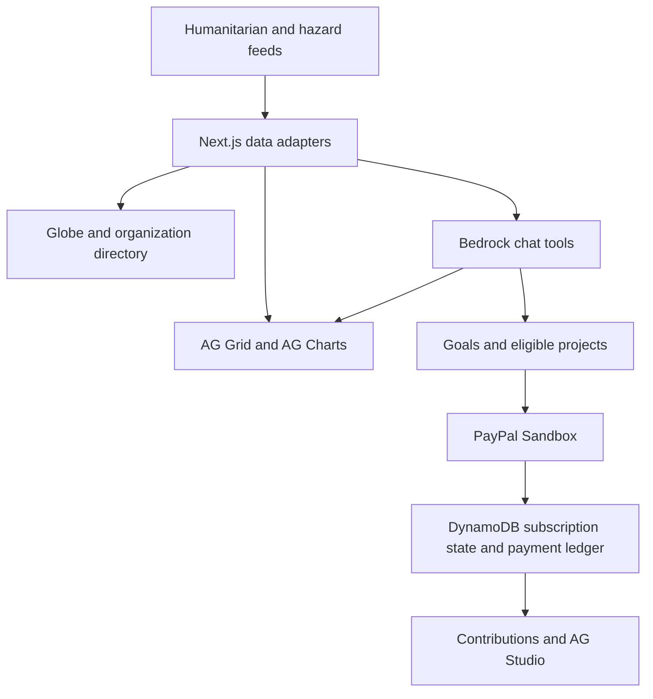
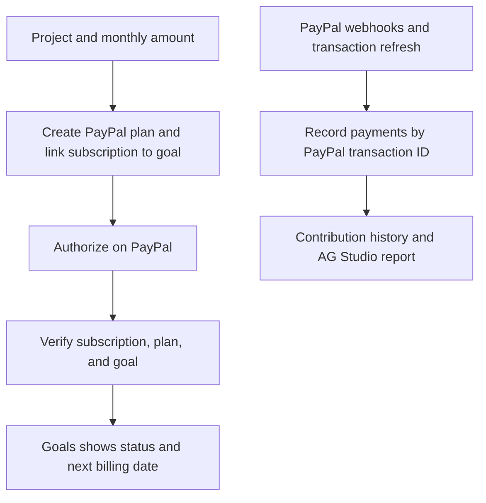

<h1 align="center">BetterSide</h1>

<p align="center">
  <a href="https://betterside.nairobilaboratories.com/">Open BetterSide</a> · PayPal AI Hackathon
</p>

<p align="center">
  
  
  
  
</p>

BetterSide is a humanitarian research and giving workspace for people deciding where to help. Explore reported needs on a globe, inspect the underlying observations in AG Grid, and look up organizations by country and sector. When you choose an eligible project, BetterSide connects your monthly contribution goal to PayPal Sandbox and brings the subscription status back into the workspace.

## System overview

Next.js routes normalize records from HDX HAPI and hazard and emergency feeds. MapLibre draws the map. AWS Bedrock powers a chat assistant that uses typed tools to query the catalogue, load trends, and prepare contribution goals. Cognito handles sign-in. DynamoDB stores goals, subscription state, contribution records, and shared public feed data.



## Explore and compare humanitarian data

Choose a country and cause on the globe, open a record, and check its measure, reporting period, and source. Search the organization directory by place or sector and pin items for later. HDX HAPI supplies indicators such as IPC food insecurity, IOM internal displacement, and OCHA appeal funding. USGS, GDACS, NASA EONET, and IFRC GO supply hazard and emergency records.

In the demo, open the Hunger record for Palestine and ask chat how food insecurity in Gaza has changed. AG Charts plots the returned IPC series. Switch to **Compare data** and expand the series in AG Grid to see the count, assessment dates, and source for each observation. The grid can export the data to Excel. The full **Records** table also lets you sort and filter the catalogue by fields such as cause, value, and reference date.

## Set up a monthly contribution

Choose an eligible project and confirm the monthly amount in Goals or chat. BetterSide uses the PayPal Subscriptions API to create the billing plan and associate the subscription with the goal. You review and authorize recurring billing on PayPal. BetterSide verifies the returned subscription against the stored plan and goal, then displays its status and next billing date. The goal has controls to pause, resume, or cancel.



Signed PayPal webhooks and explicit refresh reconcile completed transactions into DynamoDB. The payment ledger uses PayPal transaction IDs to prevent double counting. Contributions displays payment history, and the AG Studio report in chat adds totals, a chart grouped by project or month, and a filterable receipt grid.

## Local development

Use Node.js 22.18 or later and pnpm.

```bash
pnpm install
cp .env.example .env.local
```

1. Provision the [data and Bedrock stack](infra/betterside.json) and the [Cognito stack](infra/auth.json). Use the stack outputs and scoped AWS credentials to fill in [.env.example](.env.example)'s settings in `.env.local`.
2. Generate an [HDX HAPI app identifier](https://hdx-hapi.readthedocs.io/en/latest/getting-started/#generating-a-key) and set `HDX_HAPI_APP_IDENTIFIER`. For **Sign in with demo**, configure a confirmed Cognito test user with the `DEMO_ACCOUNT_*` settings.
3. Configure the PayPal Sandbox merchant app and a separate test buyer. Set `PAYPAL_ENVIRONMENT=sandbox`, the client credentials, merchant ID, and webhook ID. Point the webhook at a publicly reachable HTTPS instance's `/api/paypal/webhook` and enable subscription lifecycle and sale events.
4. Set the AG Grid and AG Studio license variables in `.env.example` when running licensed analytics.

```bash
pnpm seed
pnpm dev
```

Open [localhost:3000](http://localhost:3000). Use `pnpm test` for unit tests, `pnpm test:tools` for tool and feed integration tests, and `pnpm typecheck` and `pnpm build` to verify the application.

## License

BetterSide is available under the [MIT License](LICENSE).
