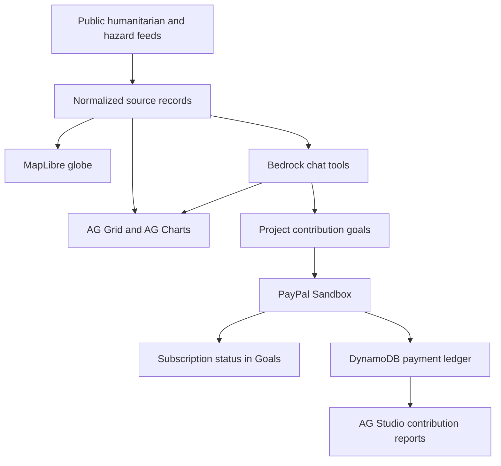
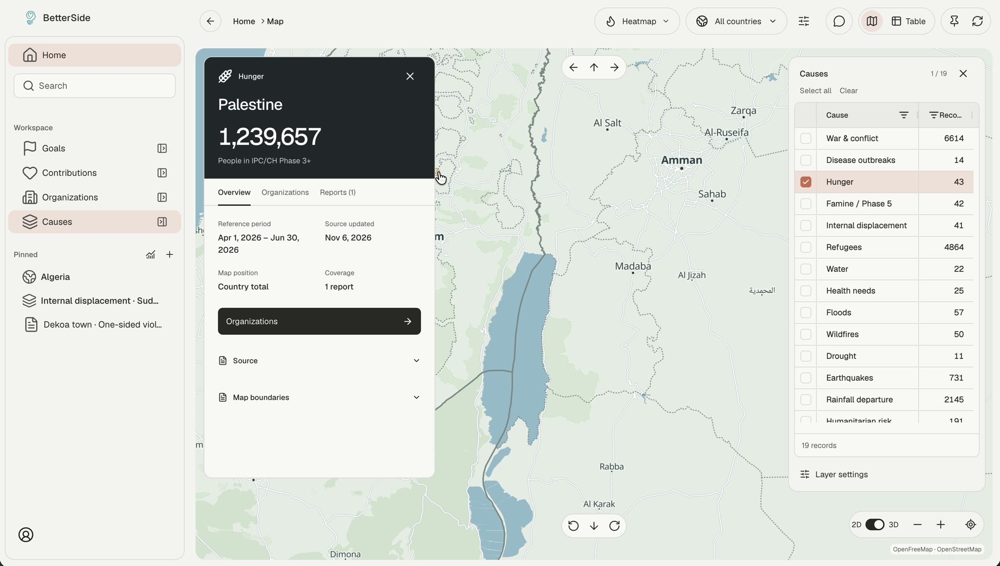
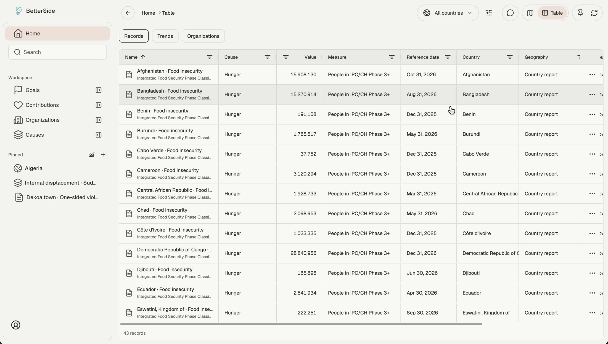
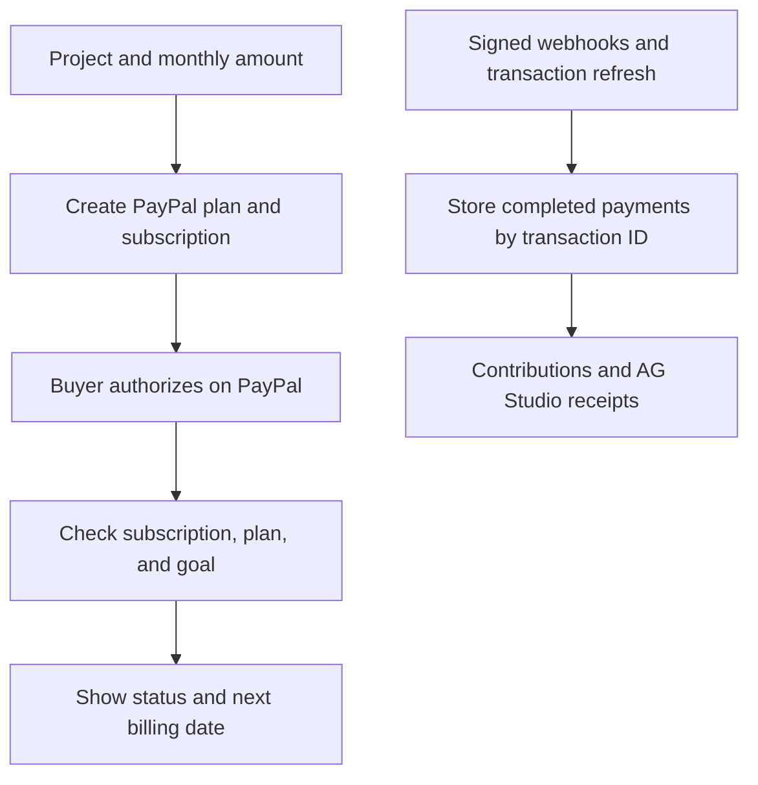
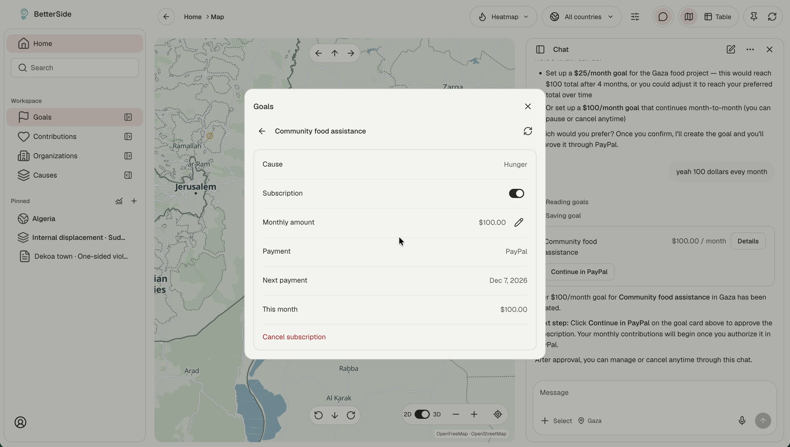

<h1 align="center">BetterSide</h1>

<p align="center">
  <a href="https://betterside.nairobilaboratories.com/">Open BetterSide</a> · PayPal AI Hackathon
</p>

<p align="center">
  
  
  
  
</p>

BetterSide is a humanitarian research and giving workspace for people deciding where to help. Explore reported needs on a globe, inspect the underlying observations in AG Grid, and look up organizations by country and sector. When you choose an eligible project, BetterSide connects your monthly contribution goal to PayPal Sandbox and brings the subscription status back into the workspace.

<table width="100%">
  <tr>
    <td width="50%" valign="top">
      <h3>Explore reported needs</h3>
      <p>Browse the globe by country and cause. Open a record to see the measure, assessment period, and original source.</p>
    </td>
    <td width="50%" valign="top">
      <h3>Compare observations</h3>
      <p>Ask chat for a historical series, view it in AG Charts, and inspect or export the underlying rows in AG Grid.</p>
    </td>
  </tr>
  <tr>
    <td width="50%" valign="top">
      <h3>Find organizations</h3>
      <p>Search by country or sector to see where organizations report working. Save a place, cause, or organization to revisit.</p>
    </td>
    <td width="50%" valign="top">
      <h3>Manage recurring support</h3>
      <p>Set up a monthly goal through PayPal Sandbox. Check the billing schedule in Goals and review recorded payments in AG Studio.</p>
    </td>
  </tr>
</table>

## System overview

Next.js routes normalize records from HDX HAPI and hazard and emergency feeds. MapLibre draws the map. AWS Bedrock powers a chat assistant that uses typed tools to query the catalogue, load trends, and prepare contribution goals. Cognito handles sign-in. DynamoDB stores goals, subscription state, contribution records, and shared public feed data.

The same source records feed the globe, chat, and data comparison views. Contribution goals follow a separate path through PayPal approval and payment reporting.



## Explore and compare humanitarian data

### Globe and organization directory

Choose a country and cause on the globe, open a record, and check its measure, reporting period, and source. Search the organization directory by place or sector and pin items for later. HDX HAPI supplies indicators such as IPC food insecurity, IOM internal displacement, and OCHA appeal funding. USGS, GDACS, NASA EONET, and IFRC GO supply hazard and emergency records.

The globe shows event coordinates for individual incidents and area summaries for records reported at country or district level. The Organizations directory shows reported operating areas and sectors. A saved pin can reopen a country and cause together, an organization, or an individual record.



### Records, trends, and chat

The **Records** table uses AG Grid to sort and filter the catalogue by fields such as cause, value, and reference date. Chat can use the selected record to answer a follow-up about its measure or retrieve the associated historical series. The assistant calls tools with structured inputs, and the application renders the returned records and measurements beside the answer.



AG Charts plots the dated observations. In **Compare data**, AG Grid lets you group series, expand them to inspect the underlying observations, and export them to Excel. BetterSide keeps the source, population, geography, and unit attached to each series. For example, an IOM internal displacement series and a UNHCR refugee series stay separate because they measure different populations.

### Source updates and coverage

Each observation keeps its assessment period separate from the publisher's update date. Trends use the period the measurement describes. The history request uses the selected country, cause, or record to retrieve relevant observations. Shared caching lets requests reuse provider responses, and the interface surfaces source failures where they affect the results.

## Set up a monthly contribution

Choose an eligible project and confirm the monthly amount in Goals or chat. BetterSide uses the PayPal Subscriptions API to create the billing plan and associate the subscription with the goal. You review and authorize recurring billing on PayPal. BetterSide verifies the returned subscription against the stored plan and goal, then displays its status and next billing date. The goal has controls to pause, resume, or cancel.

Approval updates the subscription and its billing schedule. Completed payments arrive through a separate reconciliation path.





Signed PayPal webhooks and explicit refresh reconcile completed transactions into DynamoDB. The payment ledger uses PayPal transaction IDs to prevent double counting. Contributions displays payment history, and the AG Studio report in chat adds totals, a chart grouped by project or month, and a filterable receipt grid.

### Subscription status and payment history

An active subscription establishes the billing schedule. A completed transaction creates a ledger entry tied to the project. Goals reads the subscription state, while Contributions and AG Studio read the ledger. This allows the workspace to show the next billing date before the first completed payment appears in history.

The assistant can prepare a goal and show the PayPal approval link. The buyer authorizes the subscription on PayPal. For one-time contributions, the PayPal JavaScript SDK opens checkout and the Orders API creates and captures the order.

## Local development

Use Node.js 22.18 or later and pnpm.

```bash
pnpm install
cp .env.example .env.local
```

1. Provision the [data and Bedrock stack](infra/betterside.json) and the [Cognito stack](infra/auth.json). Use the stack outputs and scoped AWS credentials to fill in [.env.example](.env.example)'s settings in `.env.local`.
2. Generate an [HDX HAPI app identifier](https://hdx-hapi.readthedocs.io/en/latest/getting-started/#generating-a-key) and set `HDX_HAPI_APP_IDENTIFIER`. For **Sign in with demo**, configure a confirmed Cognito test user with the `DEMO_ACCOUNT_*` settings.
3. Configure the PayPal Sandbox merchant app and a separate test buyer. Set `PAYPAL_ENVIRONMENT=sandbox`, the client credentials, merchant ID, and webhook ID. Point the webhook at a publicly reachable HTTPS instance's `/api/paypal/webhook` and enable subscription lifecycle and sale events.
4. Set the AG Grid and AG Studio license variables in `.env.example` when running licensed analytics.

```bash
pnpm seed
pnpm dev
```

Open [localhost:3000](http://localhost:3000). Use `pnpm test` for unit tests, `pnpm test:tools` for tool and feed integration tests, and `pnpm typecheck` and `pnpm build` to verify the application.

## License

BetterSide is available under the [MIT License](LICENSE).
